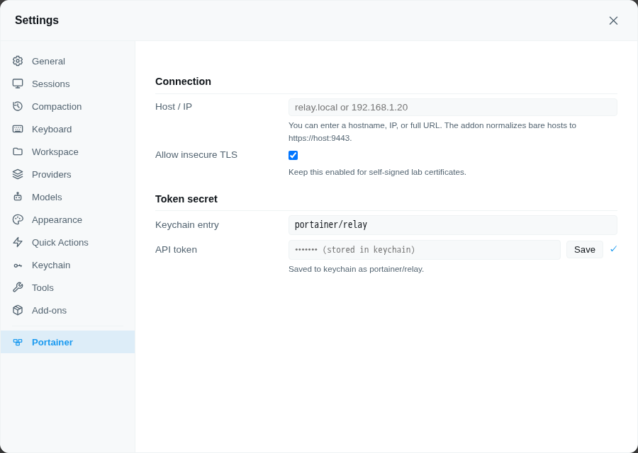

# Portainer

Portainer API management through one session-scoped `portainer` tool. Requires Piclaw `>=1.8.0`.

## Install and configure

Open **Settings → Add-Ons**, install **portainer**, then configure **Settings → Portainer**.

Non-secret defaults use `/agent/addons/api/portainer/config` and extension KV. Store the API token in the keychain; the default entry is `portainer/relay`. Hostnames and bare IP addresses are normalised to `https://<host>:9443`.

## Tool actions

- `get`, `set`, `clear` — session override management
- `discover` — find settings, environment, and keychain candidates
- `contract`, `capabilities`, `workflow_help`, `request_help`, `recommend` — inspect the tool contract before calling it
- `request` — one raw Portainer API request or a bounded sequential batch
- `workflow` — named endpoint, stack, container, image, network, or volume workflow

Use `portainer capabilities` for workflow families and `portainer workflow_help` for required fields. Raw requests support retries, throttling, per-request timeouts, and optional workspace JSON/JSONL output.

## Security and scope

- Secrets are resolved from keychain-backed environment/runtime access and are never returned in tool details.
- Self-signed TLS is allowed only when `allow_insecure_tls` is enabled.
- Mutating and destructive workflows require explicit fields; inspect workflow help before bulk upgrades, deletes, or prunes.

## Skill

The bundled `portainer-container-compare-chart` skill collects bounded container stats through the tool and renders SVG/CSV comparison artifacts.

## Settings field appearance (0.1.9)

Text-like fields use the host's shared `settings-addon-*` controls and associated
labels, matching core Settings in Classic and Visual without changing save
payloads, defaults or secret handling. A package-local layered stylesheet keeps
older supported hosts readable; host rules take precedence when available.
Native checkboxes and action buttons retain their own control roles.

## Operation-owned native API

`createPortainerTool(options)` exports the same schema/actions without registering an
extension or constructing an agent session/context. Required options are
`chatJid: string` and `assertCurrent(): void`. A supplied `chat_jid` must match
that captured chat; omission uses the captured chat, never an ambient default.
`getPortainerPrompt()` returns the complete lifecycle prompt text without callbacks.
The default extension still registers its tool, lifecycle hook and static skill.

Optional invocation-local ports:
- `transport`: RequestExecutor (exported from `client.ts`); defaults to the existing
  production transport, not the legacy test-executor override.
- `credentials`: `{ get(name): Promise<KeychainEntry>, list(): KeychainEntryMetadata[] }`;
  defaults to the existing environment/runtime/CLI credential resolution.

Async-local authority is checked at credential lookup, HTTP dispatch, each
batch attempt/retry, profile storage and output-file effects. Workflow HTTP
steps inherit that same scope, including guest/container exec steps. Scope is
closed on completion so timed-out continuations cannot begin later effects.
Native calls do not use the legacy global `setPortainerToolHandlers` override: an
arbitrary handler cannot provide internal operation fences. No handler swaps
are performed. Already-dispatched remote effects cannot be rolled back.
