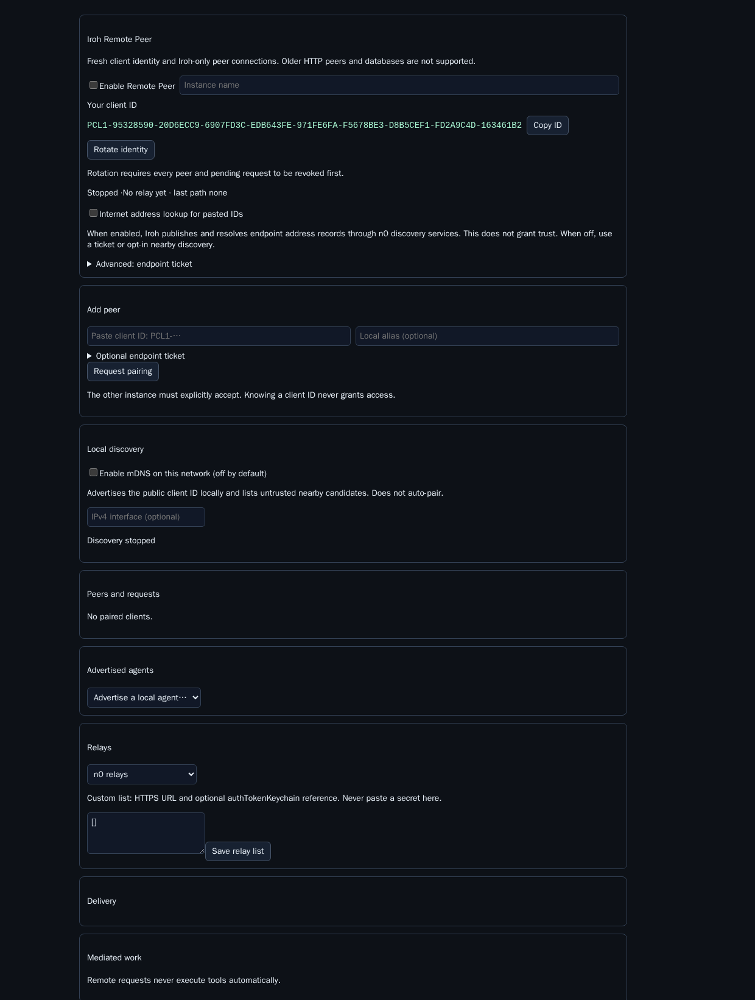
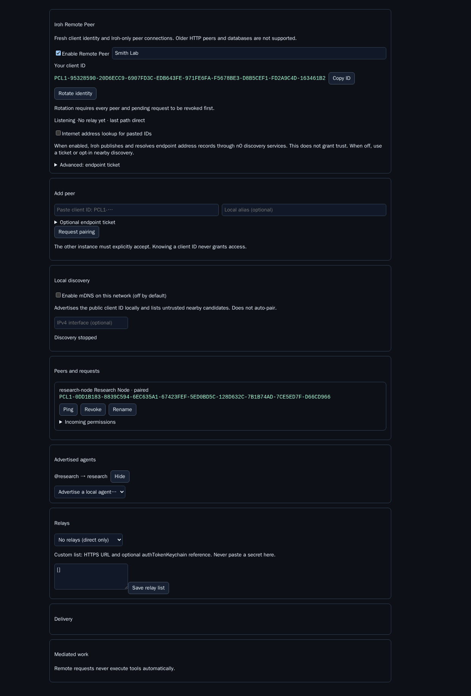

# Remote Peer operator guide

Remote Peer 0.3 connects new Piclaw clients through Iroh. It has no peer HTTP endpoint, compatibility mode or legacy database import. Install it on both instances, then pair them by client ID.

## Requirements

- Piclaw 3.0.1 or newer. Piclaw 3.0.0 lacks the process lifecycle API used to close Iroh and mDNS resources safely.
- Bun 1.4.1 or newer.
- A supported `@number0/iroh@1.1.0` prebuilt target. Published targets cover Linux x64/arm64/arm (glibc and musl variants), macOS arm64, Windows x64/arm64 and Android arm/arm64. Intel macOS is not published. No Rust compiler is needed.
- Network access to the configured Iroh relay when direct UDP connectivity is unavailable.

Remote Peer 0.3 stores fresh state under `<addon-data>/iroh-v1/`. It does not read, migrate or delete the previous `state.db` or `identity.json`. Both ends receive new client IDs and must pair again.

## Fresh Settings



The fresh pane shows:

1. **Enable Remote Peer** — starts or stops the Iroh endpoint. It does not enable mDNS or internet address lookup.
2. **Instance name** — a local display label. When mDNS is enabled, nearby operators can see it.
3. **Your client ID** — the stable, checksummed `PCL1-…` identity. Copy the complete value when pairing.
4. **Internet address lookup for pasted IDs** — publishes and resolves Iroh endpoint addresses through n0 services. It is off by default and does not grant trust.
5. **Advanced endpoint ticket** — exports endpoint ID, relay and direct-address hints. Tickets allow pairing when internet address lookup is off.
6. **Add peer** — accepts a pasted client ID, optional local alias and optional ticket.
7. **Local discovery** — mDNS advertisement and browsing. It is off by default and independent of internet address lookup.
8. **Relays** — selects n0, custom or direct-only operation. Custom credentials are keychain references, not pasted secrets.

### What enabling does

Enabling starts Iroh with the current key, relay and lookup settings. Disabling closes the endpoint and mDNS resources but retains the fresh identity, peers and delivery records. Changing runtime network settings restarts those resources inside the process; a Piclaw restart is not normally required.

## Pair by client ID

The normal flow resembles Syncthing device pairing:

1. Enable Remote Peer on both instances.
2. Copy **Your client ID** from each instance.
3. Choose one address mechanism:
   - Enable **Internet address lookup** on both ends for ID-only internet pairing.
   - Keep lookup off and exchange an **endpoint ticket**.
   - Enable mDNS on the local network, select a discovered candidate, and use its client ID/address hint.
4. On instance A, paste B's ID under **Add peer**. Supply a local alias and ticket if needed, then select **Request pairing**.
5. Instance B displays an incoming request. Compare the full client ID with B's operator through a separate trusted channel.
6. Select **Accept** and paste the full ID when prompted. Knowing or discovering an ID does not bypass approval.
7. Both panes show the client as paired. Initial incoming permissions are **inbox only**, **queue only**, and **files off**.

Pair requests expire after one hour. A bounded 90-second clock tolerance applies to signed request validation. If a request expires or conflicts with another attempt, cancel it and resolve the pending/revoked record before starting again.

## mDNS discovery

mDNS is disabled by default. In that state Remote Peer creates no multicast socket, advertisement, browse query or discovery timer.

Enable **mDNS on this network** only on a trusted local segment. Remote Peer advertises a minimal public record containing protocol version, client identity, configured name and local endpoint address. Nearby records are untrusted hints: the Iroh handshake must present the advertised public key, and pairing still requires approval.

Set an IPv4 interface when the host has multiple adapters and advertisements should stay on one network. Local discovery usually does not cross VLANs, routers, VPN boundaries or Wi-Fi client-isolation policies. Manual client-ID/ticket pairing remains available if multicast is blocked.

Disabling mDNS withdraws the record, stops browsing and closes its resources. It does not disconnect paired Iroh clients.

## Internet lookup and tickets

An Iroh client ID is a public key, not a network address. ID-only internet pairing needs an address lookup service. Remote Peer uses Iroh's n0 preset only when **Internet address lookup** is enabled.

An endpoint ticket carries the same public endpoint ID plus current relay and direct-address hints. Treat tickets as public connection information: they do not contain the private key and do not grant authorization, but they can disclose reachable addresses. Verify that the ticket identity matches the client ID before approval; Remote Peer enforces this match.

## Relay settings

- **n0 relays** — use the public Iroh relay map.
- **Custom relays** — provide up to eight HTTPS relay URLs. An optional `authTokenKeychain` names an existing Piclaw keychain entry. Do not put the token itself in Settings.
- **Direct only** — disables relay fallback. Peers must have working direct UDP paths.

Iroh tries direct paths and falls back to encrypted relay transport. The Settings health area reports the home relay and last selected peer path. Relay service operators forward encrypted packets; Remote Peer payloads remain protected by QUIC identity and signed application envelopes.

## Paired clients and permissions



Each peer card provides:

- local alias changes;
- signed ping;
- revocation and later record removal;
- incoming messaging scope;
- allowed delivery modes;
- named-agent allowlists;
- file-transfer permission.

Receiver-owned policy is enforced on every request:

| Scope | Access |
|---|---|
| `none` | No inbox, named-agent or work delivery |
| `inbox-only` | Default inbox; sessions require separate explicit grants |
| `named-agents` | Inbox plus explicitly selected advertised aliases |
| `all-advertised` | Inbox plus every enabled advertised agent alias; sessions require separate explicit grants |

Modes are `queue`, `auto` and `steer`. New pairings allow only `queue`. Files are off initially. Any broader scope, additional mode or file permission requires typing `ALLOW REMOTE ACCESS`.

Advertise only local agents that remote peers should see. Advertising an alias does not grant access by itself; each receiver-owned peer policy remains authoritative.

**Edit incoming permissions** opens one peer's saved policy as a draft. Scope,
delivery modes, named agents and incoming files are independent controls.
File-only edits retain all other fields. **Apply** writes and reads back the
complete policy; success appears only when the readback matches. **Revert**
reloads the saved policy displayed in the pane and **Cancel** discards edits;
neither writes. Failed requests retain the draft. A failed readback may follow a
successful write, so retry or Revert to reconcile rather than assuming no write.

**Outgoing permissions** are read-only and controlled by the remote peer.
**Refresh remote permissions** explicitly fetches its advertisement and shows
the fetch time. Not-yet-fetched, stale and unavailable views are labelled. Local
incoming edits cannot enable files at a remote destination. After the receiver
applies changes, refresh the sender's directory. Opening Settings alone does not
contact remote peers.

Polling preserves unsaved drafts. If another client changes the saved policy,
Apply is blocked until Revert reloads that policy. Revocation/removal and their
full-ID confirmations remain separate from the editor.

The editor sends its original policy and pairing epoch with Apply. The server
compares them atomically with the write, rejecting changes that race the next
dashboard poll. A stale draft cannot restore permissions restricted elsewhere.

## Opt in to session targets

Session delivery requires Piclaw's request-scoped local context and authenticated incarnation-bound messaging APIs. Older hosts report session targets as unavailable; named-agent and inbox delivery keep their existing behaviour.

1. Advertise the local agent under **Advertised agents**.
2. Under **Advertised sessions**, select **Refresh local session targets**. Choose an exact local target, its advertised agent alias, a public session alias and delivery modes, then select **Advertise session**. Idle targets are valid: `active` describes streaming activity.
3. Edit the intended peer's incoming permissions. Under **Sessions**, allow that session and select its modes. Type `ALLOW REMOTE ACCESS` and select **Apply**. Cancel and Revert discard drafts without writing. File-only changes retain session grants.
4. Refresh the sender's directory and use the returned `peer!@agent/session` address and modes. Outgoing Settings shows read-only session grants and `ready`, `stale` or `unreachable` status.

Neither named-agent selection nor `all-advertised` grants session access. Effective modes are the intersection of peer modes, advertised session modes and the explicit session grant. `none` scope denies session delivery.

An advertisement binds the target's chat JID and incarnation. A deleted or recreated lifetime is stale and rejects delivery, even if the chat JID is reused. No named-agent fallback runs. **Hide** removes the advertisement and its peer grants. Every advertisement or re-advertisement under the same alias clears old grants and creates a new advertisement revision, even for the same target and modes; each peer needs fresh consent. If the advertisement changes or is hidden while editing, Settings clears typed consent and blocks Apply, including when there were no saved grants. Use **Revert**, select the current session again, and type `ALLOW REMOTE ACCESS` afresh. Retyping or toggling the stale draft cannot clear the conflict. Remove one peer's session selection and Apply to revoke only that peer's grant.

## Sending and retrying

Agents use Piclaw's normal chat transport:

```text
chat({ action: "directory" })
chat({
  target_address: "lab!inbox",
  content: "Please review this",
  mode: "queue",
  idempotency_key: "review-2026-09-08"
})
```

Use only addresses and modes returned by the directory. Use `peer!@alias` only when the signed roster advertises that alias. Reply to supplied opaque `peer!reply.…` addresses unchanged.

File transfer accepts at most four files, 16 MiB each and 32 MiB total. SHA-256, declared length and filename checks run at both ends.

Outbound payloads remain stored until acknowledged. Retry a failed record with the same message ID and idempotency key. Completed retries return the stored receipt without adding a second receiver message. If a receiver crashes after local delivery but before committing its receipt, the record remains ambiguous and Remote Peer refuses blind redelivery. Inspect the target timeline before resolving it.

## Mediated work

`work_send` records proposal and execute-labelled requests. Both require local operator review at the receiver; neither grants remote tool execution. `work_review` returns a reviewed result and only permits approved capability labels that were requested.

Terminal results remain visible in Settings even when no origin chat was supplied. If local notification enqueueing fails, the same signed terminal result retries the pending notification. A crash after enqueueing leaves an unknown notification outcome rather than risking a duplicate.

## Revocation, removal and rotation

Revocation changes the authorization epoch, closes access locally and invalidates all reply capabilities for that peer. Remote notification is best-effort; an offline peer may temporarily display stale state but cannot use the old epoch.

A revoked record remains blocked. **Remove revoked record** requires full client-ID confirmation before the same public key can request pairing again. Old private-chat reply capabilities remain invalid across re-pairing.

Identity rotation requires every peer and pending request to be revoked first, followed by full current-ID confirmation. Rotation:

- clears fresh Iroh trust, queues, replies, work records and advertised-agent entries;
- writes and fsyncs a new 32-byte key;
- produces a new client ID;
- requires explicit new pairing everywhere;
- leaves pre-0.3 legacy files untouched.

Back up the entire `iroh-v1` directory with Piclaw stopped or through a consistent SQLite backup. Losing `secret-key.bin` changes the client ID. Do not restore `peers.db` without its matching key.

## Diagnostics

Use Settings health, delivery and work sections first. The `remote_peer` management tool also provides `status`, `identity`, `ticket`, `pair`, `accept`, `deny`, `revoke`, `forget`, `alias`, `policy`, `remote_permissions`, `advertise`, `unadvertise`, `session_targets`, `session_advertise`, `session_unadvertise`, `ping`, `retry`, `work_send` and `work_review`.

See [troubleshooting](troubleshooting.md), [protocol](protocol.md), [security boundaries](security.md), [mediated work](mediated-work.md) and [implementation evidence](e2e-matrix.md).
